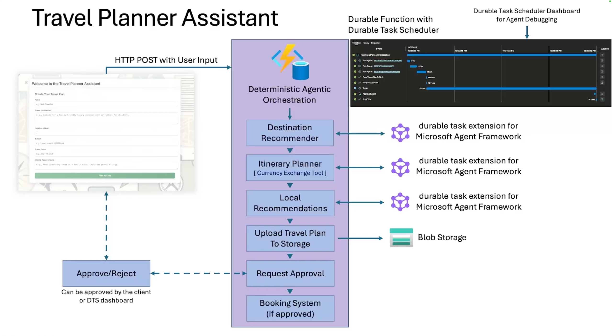

# AI Agent Orchestrator - Travel Planner

A sophisticated travel planning application that leverages Azure AI Agents and Durable Functions to create comprehensive travel plans through a coordinated workflow of specialized AI agents.

## Overview

The AI Agent Orchestrator Travel Planner demonstrates an agentic workflow using specialized AI agents and Azure Durable Functions to create personalized travel experiences. Each agent specializes in a specific aspect of travel planning, working together to produce a comprehensive travel plan that users can review and approve.

## Architecture



### Components

1. **Frontend Interface**: React-based web application for user interaction
2. **HTTP Trigger API**: Entry point for client requests
3. **Durable Functions Orchestrator**: Coordinates the workflow between specialized agents
4. **Specialized AI Agents**:
   - Destination Recommender Agent
   - Itinerary Planner Agent
   - Local Recommendations Agent
5. **Blob Storage**: Stores generated travel plans
6. **Approval System**: Human-in-the-loop verification before booking

## Why Agentic Workflow with Durable Functions?

Travel planning inherently follows a structured sequence - selecting destinations, crafting itineraries, and gathering local insights, making it ideal for an agentic workflow with pre-defined steps, rather than self-directed agent exploration. This approach provides greater determinism and predictability in results, ensuring consistent high-quality travel plans with each execution. While autonomous agents excel at unpredictable, creative tasks, they can be inefficient and inconsistent for well-defined processes like travel planning that benefit from structured, predictable workflows.

The agentic workflow interacts with specialized (sub) agents at the first three stages:

1. A **destination recommender agent** provides global knowledge across thousands of locations
2. A **itinerary planner agent** creates a daily itinerary based on a deep understanding of a specific destination's logistics and seasonal considerations
3. A **local recommendations agent** provides popular attractions to visit

By using Durable Functions to coordinate specialized agents, the travel agent can create a more accurate and comprehensive travel plan than a single generalist agent. Once the travel plan has been created, Durable Function orchestrations provide built-in support for human interaction. In this case, it allows for human approval of the travel plan before proceeding to book the trip.

Seeking this approval can be a long-running operation that may encounter failures along the way. However, by leveraging Durable Functions, the application benefits from resiliency through built-in state persistence, ensuring the orchestration can resume in the event of a failure, such as a downstream dependency outage.

## How the Application Works

### Step 1: User Request

The user fills out a travel request form with preferences, budget, and other requirements in the React frontend application.

### Step 2: HTTP Trigger Invocation

The request is sent to an HTTP-triggered Azure Function that starts a new Durable Functions orchestration instance.

### Step 3: Destination Recommendation

The orchestrator invokes the Destination Recommender Agent activity, which analyzes the user's preferences and suggests the most suitable destinations.

### Step 4: Itinerary Planning

Once destinations are selected, the orchestrator invokes the Itinerary Planner Agent activity to create a detailed day-by-day plan tailored to the chosen location.

### Step 5: Local Recommendations

The orchestrator invokes the Local Recommendations Agent activity to enhance the itinerary with insider tips, hidden gems, and popular attractions.

### Step 6: Travel Plan Storage

The complete travel plan is saved to Azure Blob Storage, and a document URL is generated for user access.

### Step 7: Approval Request

The travel plan is presented to the user for approval via the frontend interface.

### Travel-plan blob retention

The sample writes documents to the private `travel-plans` container and configures no automatic expiry or cleanup job. Treat the returned blob URL as a location, not a public download link or a retention guarantee. Reading it still requires authorized storage access.

Retain documents throughout the approval wait (up to seven days), booking/recovery, and the period during which users need to retrieve the plan or retained orchestration output. For production, choose an explicit business/privacy retention period, then delete eligible documents after those requirements end; coordinate this with durable history retention so saved URLs do not unexpectedly point to deleted plans. A lifecycle rule based only on blob age can delete a plan while approval or recovery is still pending. Account for soft-delete and version retention, which can retain data and incur charges after deletion. Deleting the dedicated sample environment removes its storage; do not delete a shared storage account to clean up travel plans.

### Step 8: Booking Process (Conditional)

If approved, the orchestrator proceeds with the booking process. If rejected, it can either terminate or restart with modified preferences.

### Step 9: Confirmation

Upon successful booking, the user receives a final confirmation with all travel details.

## Prerequisites

- Docker
- .NET 10 SDK
- Azure Functions Core Tools v4
- Node.js 22.12+ and npm (required by the frontend's Azure Storage and Vite dependencies)
- Azure Developer CLI (azd)
- Azure Subscription with:
  - Azure Functions resource
  - Azure Storage Account
  - Azure Durable Task resource
  - Microsoft Foundry project with configured agents

## Telemetry

The Functions host uses OpenTelemetry. Set `APPLICATIONINSIGHTS_CONNECTION_STRING` to export worker telemetry, including outbound HTTP dependency traces, to Azure Monitor. Without the connection string, the worker does not export. When `AzureMonitorExporter__credential` is not set, the worker uses the connection string without Microsoft Entra authentication, which requires local authentication to be enabled on the Application Insights resource.

To opt in to Microsoft Entra authentication for worker telemetry, set `AzureMonitorExporter__credential` to `managedidentity` and grant the identity the Monitoring Metrics Publisher role on the Application Insights resource. For a user-assigned identity, also set `AzureMonitorExporter__clientId` to its client ID. Configure host telemetry separately with `APPLICATIONINSIGHTS_AUTHENTICATION_STRING` (for example, `Authorization=AAD;ClientId=<client-id>` for a user-assigned identity). The supplied Bicep template configures both host and worker to use its managed identity and disables local authentication by default.

`AZURE_TENANT_ID` and `AZURE_CLIENT_ID` are still required by the agent and storage setup, regardless of the telemetry authentication method.

## Setting Up Locally

### 1. Clone the Repository

```bash
git clone https://github.com/Azure-Samples/Durable-Task-Scheduler.git
cd Durable-Task-Scheduler/samples/durable-functions/dotnet/AiAgentTravelPlanOrchestrator
```

### 2. Configure Environment Variables

Create a `local.settings.json` file in the root directory with the following content:

```json
{
  "IsEncrypted": false,
  "Values": {
    "AzureWebJobsStorage": "UseDevelopmentStorage=true",
    "FUNCTIONS_WORKER_RUNTIME": "dotnet-isolated",
    "DURABLE_TASK_SCHEDULER_CONNECTION_STRING": "Endpoint=http://localhost:32768;Authentication=None",
    "TASKHUB_NAME": "default",
    "AZURE_TENANT_ID": "<your tenant id>",
    "AZURE_CLIENT_ID": "<your client id>",
    "DESTINATION_RECOMMENDER_CONNECTION": "<PROJECT_ENDPOINT>",
    "ITINERARY_PLANNER_CONNECTION": "<PROJECT_ENDPOINT>",
    "LOCAL_RECOMMENDATIONS_CONNECTION": "<PROJECT_ENDPOINT>",
    "DESTINATION_RECOMMENDER_AGENT_ID": "<DESTINATION_RECOMMENDER_AGENT_ID>",
    "ITINERARY_PLANNER_AGENT_ID": "<ITINERARY_PLANNER_AGENT_ID>",
    "LOCAL_RECOMMENDATIONS_AGENT_ID": "<LOCAL_RECOMMENDATIONS_AGENT_ID>"
  },
  "Host": {
    "LocalHttpPort": 7071,
    "CORS": "*",
    "CORSCredentials": false
  }
}
```

Replace the placeholder values with your Microsoft Foundry project endpoint and agent IDs. The `*_CONNECTION` settings must be the project endpoint URL, for example `https://<foundry-resource>.services.ai.azure.com/api/projects/<project>`. Hub-based project connection strings (`<region>.api.azureml.ms;...`) aren't supported by the `Azure.AI.Projects` 2.x SDK used by this sample.

### 3. Set Up Azure Storage Emulator

For local development, install and start Azurite:

```bash
# If using Azurite via npm
npm install -g azurite
azurite
```

### 4. Run the Durable Task Scheduler Locally

```bash
docker run --name dtsemulator -d -p 8080:8080 -p 8082:8082 mcr.microsoft.com/dts/dts-emulator:latest
```

### 5. Run Backend Functions

Start the Azure Functions project in the root directory:

```bash
func start
```

### 6. Run Frontend Application

Open a new terminal window and navigate to the Frontend directory:

```bash
cd Frontend
npm install
npm start
```

The application will be accessible at `http://localhost:3000`. In development, the frontend calls `http://localhost:7071/api` by default. If you run the Functions host on a different port, create `Frontend/.env` with `VITE_API_URL=http://localhost:<port>/api`.

## Deploying to Azure

### 1. Prerequisites

Ensure you have Azure Developer CLI (azd) installed:

#### Windows

```PowerShell
winget install microsoft.azd
azd version
```

#### Mac

```bash
brew tap azure/azd && brew install azd
azd version
```

#### Linux

```bash
curl -fsSL https://aka.ms/install-azd.sh | bash
azd version
```

Login to your Azure account:

```bash
azd auth login
```

### 2. Initialize Azure Resources

Initialize the Azure Developer CLI in your project:

```bash
azd init
```

Follow the prompts to configure your environment settings.

### 3. Provision Resources and Deploy

Use the Azure Developer CLI to provision all necessary resources and deploy your application. Set `SWA_CLI_DEPLOY_ENV=production` first so the frontend deploys to the Static Web App production environment, where the linked backend is available (see the note in [step 6](#6-deploy-react-web-app)).

#### Bash

```bash
export SWA_CLI_DEPLOY_ENV=production
azd up
```

#### PowerShell

```PowerShell
$env:SWA_CLI_DEPLOY_ENV = "production"
azd up
```

This command will:

- Create all required Azure resources as defined in your infrastructure files, including a Microsoft Foundry resource, a Foundry project, and a `gpt-5-mini` model deployment
- Build the backend Azure Functions
- Build and deploy the frontend Vite React application
- Configure the function app with the Foundry project endpoint and grant its managed identity the **Foundry User** role (formerly **Azure AI User**) on the Foundry resource

> [!NOTE]
> Choose `eastus2` as the location. It supports Durable Task Scheduler, Azure Static Web Apps, and `gpt-5-mini` `GlobalStandard` for Foundry Agent Service. To use a different model, set the `modelName`, `modelVersion`, `modelSkuName`, and `modelCapacity` parameters in `infra/main.bicep`.

> [!IMPORTANT]
> By default, the Foundry resource allows public network access so that the function app can reach it. The template doesn't create a private endpoint for Foundry. To block public access, run `azd env set AI_PUBLIC_NETWORK_ACCESS Disabled` before `azd up`, and provide your own private endpoint and virtual network integration so the function app can still reach the Foundry project.
>
> The default `skipVnet=true` deployment is not a private deployment. Private Function App ingress also requires a private endpoint. The Static Web App linked backend configures Function App authentication; direct API calls must satisfy that authentication and may return 401 without it.

### 4. Configure AI Agents

After deployment, create the three agents in the Foundry project. You can create them in the [Foundry portal](https://ai.azure.com) or by calling the Agent Service REST API with the deployed model. The deploying user is granted the **Foundry User** role on the Foundry resource, which is required to create agents. Role assignments can take a few minutes to take effect.

Use the following instructions for each agent:

#### Destination Recommender Agent

**System Prompt Example:**

```text
You are a destination recommendation expert that helps travelers find ideal 
vacation spots based on their preferences, budget, and travel dates. 
Analyze the user's preferences carefully and suggest 1-3 destinations 
with a brief explanation of why each is suitable. 
```

#### Itinerary Planner Agent

**System Prompt Example:**

```text
You are an itinerary planning expert that creates detailed day-by-day travel plans.
Generate a comprehensive itinerary for the requested destination including 
accommodations, activities, transportation, and estimated costs. 
```

#### Local Recommendations Agent

**System Prompt Example:**

```text
You are a local guide expert that provides insider knowledge about destinations.
Focus on both popular and hidden gem attractions, dining options across different
price ranges, and practical local tips that tourists wouldn't typically know.
```

For example, the following PowerShell script creates the destination recommender agent and returns its ID. Repeat it for the other two agents with their names and instructions.

```PowerShell
$projectEndpoint = azd env get-value PROJECT_ENDPOINT
$model = azd env get-value AI_MODEL_DEPLOYMENT_NAME
$token = az account get-access-token --resource https://ai.azure.com --query accessToken -o tsv
$body = @{
  name         = "destination-recommender"
  model        = $model
  instructions = "You are a destination recommendation expert that helps travelers find ideal vacation spots based on their preferences, budget, and travel dates."
} | ConvertTo-Json

$agent = Invoke-RestMethod -Method Post -Uri "$projectEndpoint/assistants?api-version=2025-05-01" `
  -Headers @{ Authorization = "Bearer $token" } -ContentType "application/json" -Body $body
$agent.id
```

### 5. Update Configuration

Set the agent IDs (they start with `asst_`) and reprovision to update the function app settings. The `*_CONNECTION` settings are already set to the Foundry project endpoint by the template.

```bash
azd env set DESTINATION_RECOMMENDER_AGENT_ID "your-agent-id"
azd env set ITINERARY_PLANNER_AGENT_ID "your-agent-id"
azd env set LOCAL_RECOMMENDATIONS_AGENT_ID "your-agent-id"

# Apply these changes to your Azure resources
azd provision
```

### 6. Deploy React Web App

The deployed frontend uses the Static Web App's linked Function App backend at `/api` by default. To override this, set `VITE_API_URL` in `Frontend/.env.production` to the desired API endpoint.

> [!IMPORTANT]
> With azd 1.33 and Static Web Apps CLI 2.1, `azd deploy web` deployed the frontend to a preview environment that doesn't have the linked backend, so `/api` calls failed. Setting `SWA_CLI_DEPLOY_ENV=production` before deploying sent the frontend to the production environment, where the linked backend is available. This workaround was tested with `azd deploy --all`; it hasn't been verified as part of a complete `azd up` run. If the variable isn't set in your current shell, set it again before deploying.

#### Bash

```bash
export SWA_CLI_DEPLOY_ENV=production
azd deploy --all
```

#### PowerShell

```PowerShell
$env:SWA_CLI_DEPLOY_ENV = "production"
azd deploy --all
```

## Clean up

Once you've finished your testing, clean up and remove resources to save on costs.

```bash
azd down --purge
```

## Learn More

- [Azure Durable Task Scheduler](https://learn.microsoft.com/en-us/azure/azure-functions/durable/durable-task-scheduler/quickstart-durable-task-scheduler?pivots=csharp)
- [Azure Durable Functions Documentation](https://docs.microsoft.com/en-us/azure/azure-functions/durable/durable-functions-overview)
- [Microsoft Foundry Agent Service Documentation](https://learn.microsoft.com/azure/ai-foundry/agents/overview)
- [Azure Functions Isolated Process Model](https://docs.microsoft.com/en-us/azure/azure-functions/dotnet-isolated-process-guide)
- [Azure Developer CLI Documentation](https://learn.microsoft.com/en-us/azure/developer/azure-developer-cli/)
- [Azurite Emulator](https://learn.microsoft.com/en-us/azure/storage/common/storage-use-azurite?tabs=visual-studio%2Cblob-storage)

## Contributing

Contributions are welcome! Please feel free to submit a Pull Request.

## License

This project is licensed under the MIT License - see the LICENSE file for details.
