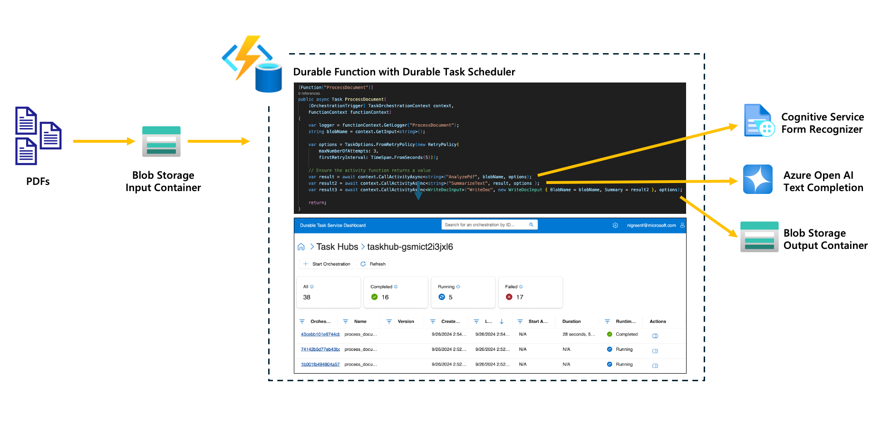
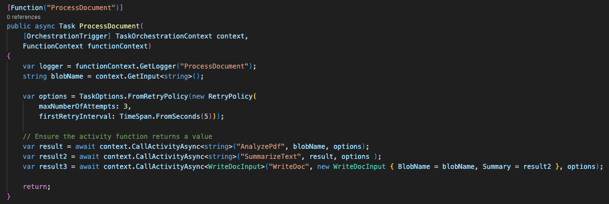
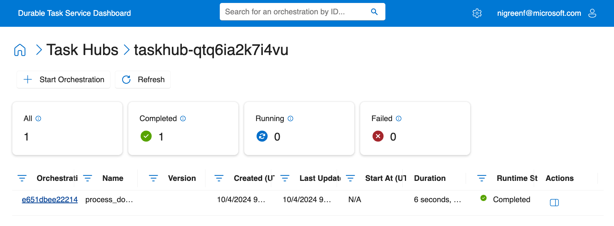
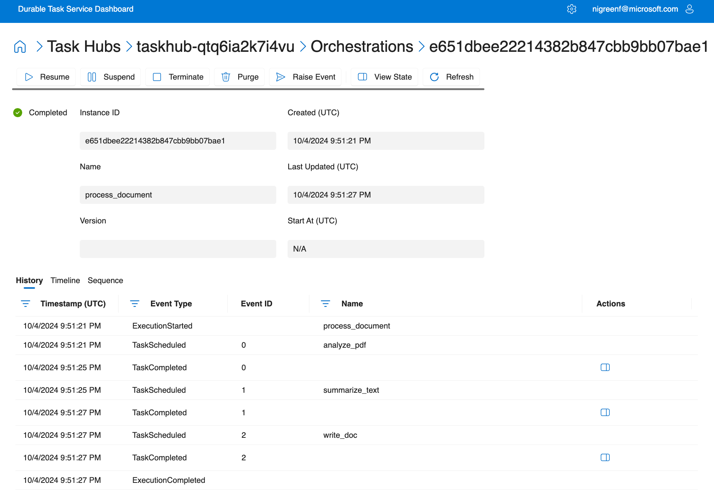
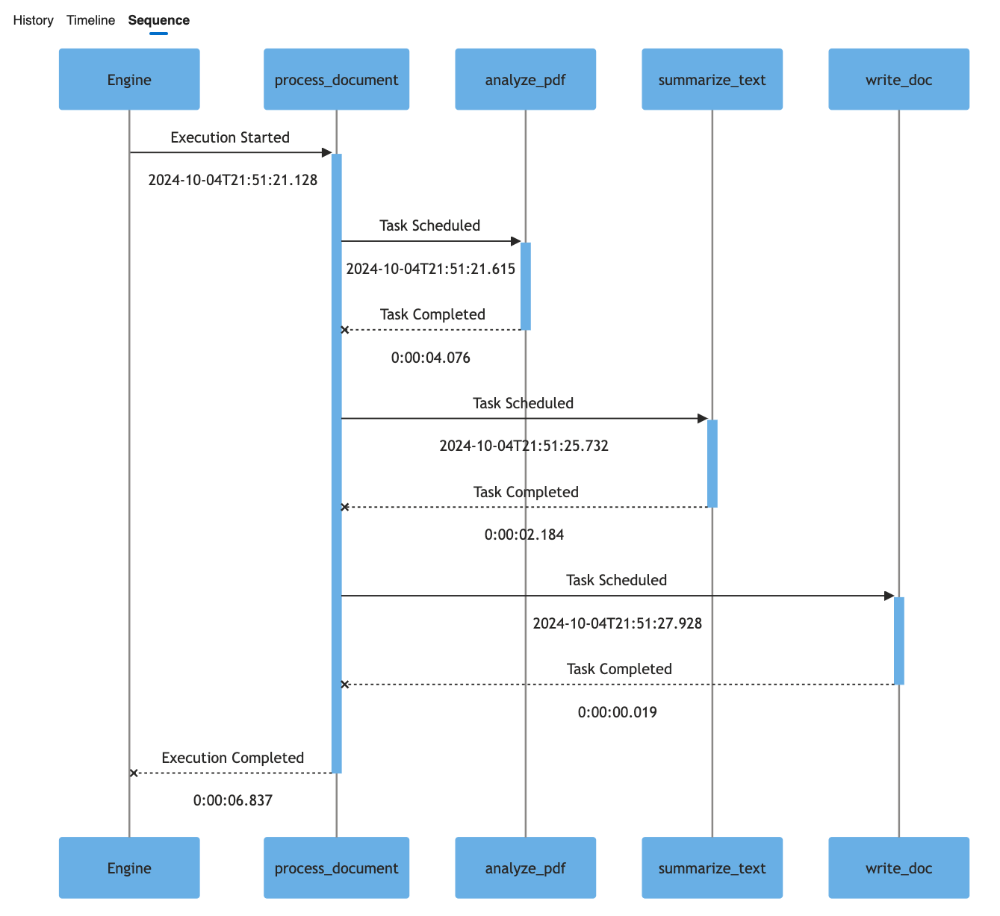

# Intelligent PDF Summarizer - .NET
The purpose of this sample application is to demonstrate how Durable Functions can be leveraged to create intelligent applications, particularly in a document processing scenario. Order and durability are key here because the results from one activity are passed to the next. Also, calls to services like Cognitive Service or LLMs are costly and should not be repeated in the event of failures.

This sample integrates various Azure services, including the new Durable Task Scheduler for Azure Durable Functions, Azure Storage, Azure Cognitive Services, and Azure Open AI.

The application showcases how PDFs can be ingested and intelligently scanned to determine their content.



The application's workflow is as follows:
1.	PDFs are uploaded to a blob storage input container.
2.	A durable function is triggered upon blob upload.
3.	The Durable Task Scheduler for Azure Durable Functions schedules an orchestration that:
- - Downloads the blob (PDF).
- - Utilizes the Azure Cognitive Service Form Recognizer endpoint to extract the text from the PDF.
- - Sends the extracted text to Azure Open AI to analyze and determine the content of the PDF.
- - Save the summary results from Azure Open AI to a new file and upload it to the output blob container.

Below, you will find the instructions to set up and run this app locally..

## Prerequisites
- [Create an active Azure subscription](https://learn.microsoft.com/en-us/azure/guides/developer/azure-developer-guide#understanding-accounts-subscriptions-and-billing).
- [Install the latest Azure Functions Core Tools to use the CLI](https://learn.microsoft.com/en-us/azure/azure-functions/functions-run-local)
- [.NET 8 SDK](https://dotnet.microsoft.com/download/dotnet/8.0)
- [Create a Durable Task Scheduler and task hub](https://learn.microsoft.com/azure/durable-task/scheduler/develop-with-durable-task-scheduler#create-a-scheduler-and-task-hub). Preview enrollment is not required.
- [Start and configure an Azurite storage emulator for local storage](https://learn.microsoft.com/azure/storage/common/storage-use-azurite).

## local.settings.json
You will need to configure a `local.settings.json` file in the sample directory (`samples/durable-functions/dotnet/PdfSummarizer`) that looks similar to the below. Make sure to replace the placeholders with your specific values.

```json
{
  "Values": {
    "AzureWebJobsStorage": "UseDevelopmentStorage=true",
    "AzureWebJobsFeatureFlags": "EnableWorkerIndexing",
    "FUNCTIONS_WORKER_RUNTIME": "dotnet-isolated",
    "DURABLE_TASK_SERVICE_CONNECTION_STRING": "Endpoint=<DTS-SCHEDULER-ENDPOINT>;Authentication=DefaultAzure",
    "TASKHUB_NAME": "<TASKHUB-NAME>",
    "COGNITIVE_SERVICES_ENDPOINT": "<COGNITIVE-SERVICE-ENDPOINT>",
    "AZURE_OPENAI_ENDPOINT": "<AZURE-OPEN-AI-ENDPOINT>",
    "CHAT_MODEL_DEPLOYMENT_NAME": "<AZURE-OPEN-AI-MODEL>"
  }
}
```

## Running the app locally
1. Start Azurite: Begin by starting Azurite, the local Azure Storage emulator.

2. Start the Function App: Start the function app to run the application locally.

```bash
func start --verbose
```

## Inspect the code
This app leverages Durable Functions to orchestrate the application workflow. By using Durable Functions, there's no need for additional infrastructure like queues and state stores to manage task coordination and durability, which significantly reduces the complexity for developers. 

Take a look at the code snippet below, the `ProcessDocument` defines the entire workflow, which consists of a series of steps (activities) that need to be scheduled in sequence. Coordination is key, as the output of one activity is passed as an input to the next. Additionally, Durable Functions handle durability and retries, which ensure that if a failure occurs, such as a transient error or an issue with a dependent service, the workflow can recover gracefully.



## Deploy the app to Azure
Use the [Azure Developer CLI (`azd`)](https://aka.ms/azd) to easily deploy the app. 

1. In the root of the project, run the following command to provision and deploy the app:

    ```bash
    azd up
    ```

2. When prompted, provide:
   - A name for your [Azure Developer CLI environment](https://learn.microsoft.com/en-us/azure/developer/azure-developer-cli/faq#what-is-an-environment-name).
   - The Azure subscription you'd like to use.
   - The Azure location to use.

   > **Region selection:** Durable Task Scheduler is available in [most Azure regions](https://learn.microsoft.com/azure/durable-task/scheduler/durable-task-scheduler#supported-regions), not just West US 2 and North Central US. Query the current list before selecting your AZD location:

   ```bash
   az provider show --namespace Microsoft.DurableTask --query "resourceTypes[?resourceType=='schedulers'].locations | [0]" --out table
   ```

   The template's allowed `location` values also apply. Choose a region from that list that appears in the provider output.

   The template currently deploys Azure OpenAI separately in `eastus2`. Confirm that your model and quota are available there, or change the `openAi` module's location in `infra/main.bicep`. The model endpoint and scheduler do not need to use the same region.

Once the azd up command finishes, the app will have successfully provisioned and deployed. 

# Using the app
To use the app, simply upload a PDF to the Blob Storage `input` container. Once the PDF is transferred, it will be processed using document intelligence and Azure OpenAI. The resulting summary will be saved to a new file and uploaded to the `output` container.

### Review Execution History in the Durable Task Scheduler Dashboard
Since the application leverages the Durable Task Scheduler backend storage provider for Durable Functions, all orchestration executions are persisted and can be viewed in the monitoring and management dashboard.



This dashboard enables you to monitor the status of ongoing and failed orchestrations, and troubleshoot any issues causing orchestrations to fail or become "stuck." It also displays the outputs from each activity execution. Additionally, you can use the timeline and sequence diagrams to gain insights into the orchestration execution, including the duration of each activity.



